# CityBuilder

**Turn any city into a voxel model you can explore in your browser, with one command.**

```bash
npm run city -- "Wellington, New Zealand"
npm run dev
```

CityBuilder takes the map data for a place and builds a 1-metre voxel model you can fly, walk and orbit around:
- **Map data:** streets, buildings, water, parks, trees and tram lines from [OpenStreetMap](https://www.openstreetmap.org).
- **Terrain:** hills and coastline from a global elevation model.
- **Local data:** surveyed open data where a city publishes it.

Streets line up with the voxel grid, buildings get facades, roofs and rooftop clutter, the sun follows the city's real latitude, windows light up at night and trams run on their real routes.

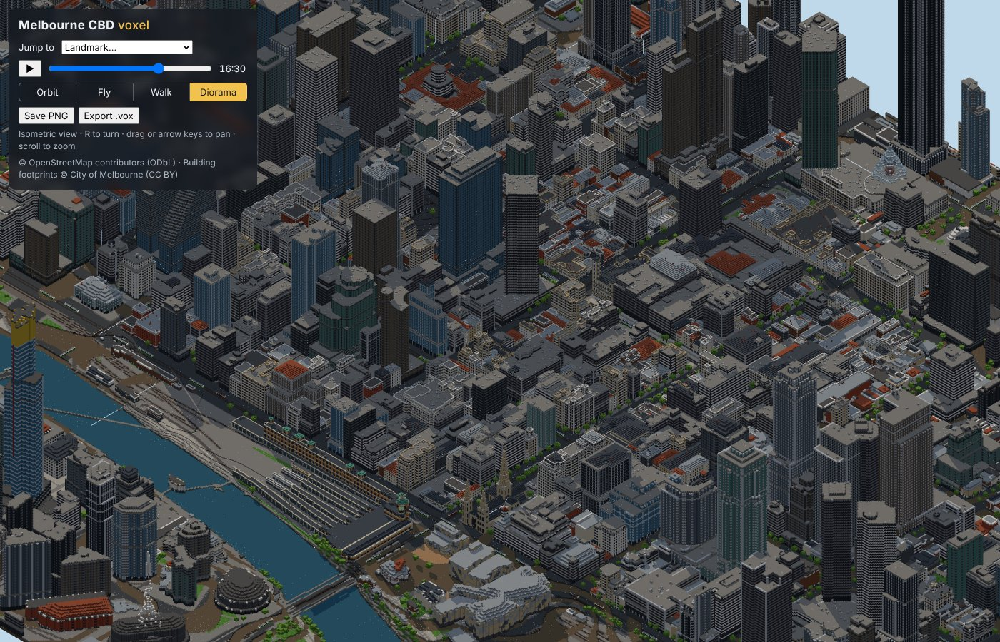

| Melbourne CBD | Southbank at dusk |
|---|---|
| 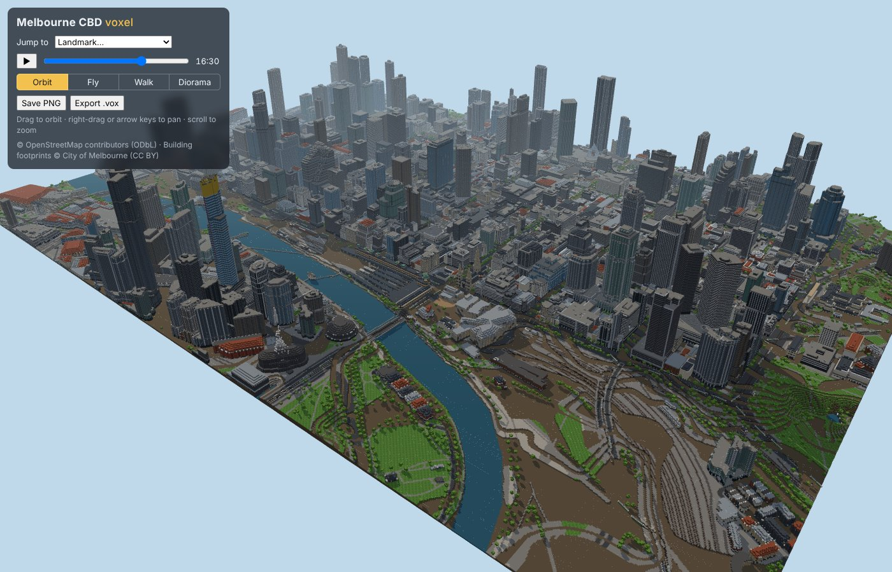 | 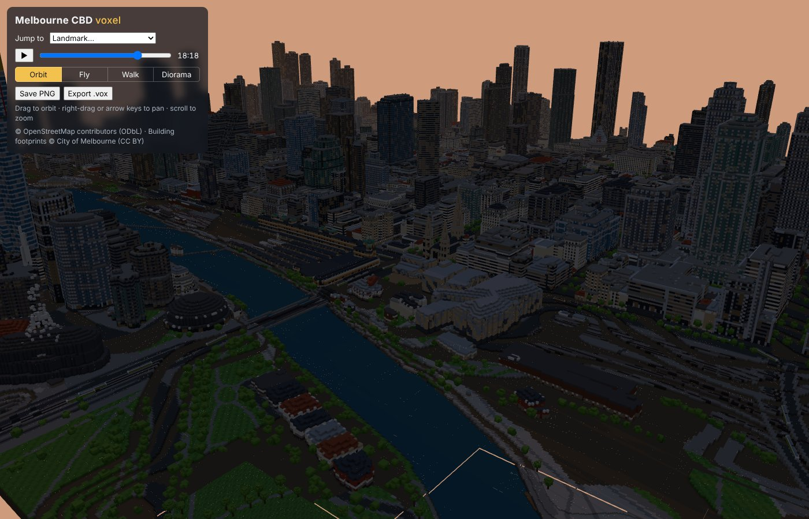 |
| **Walking up Swanston St** | **Night** |
| 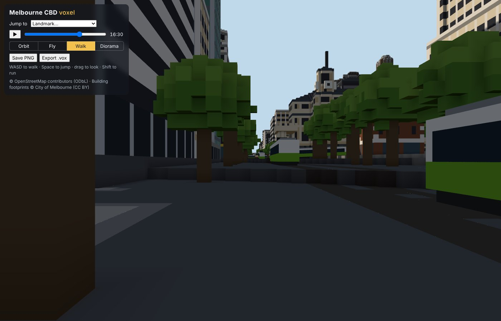 | 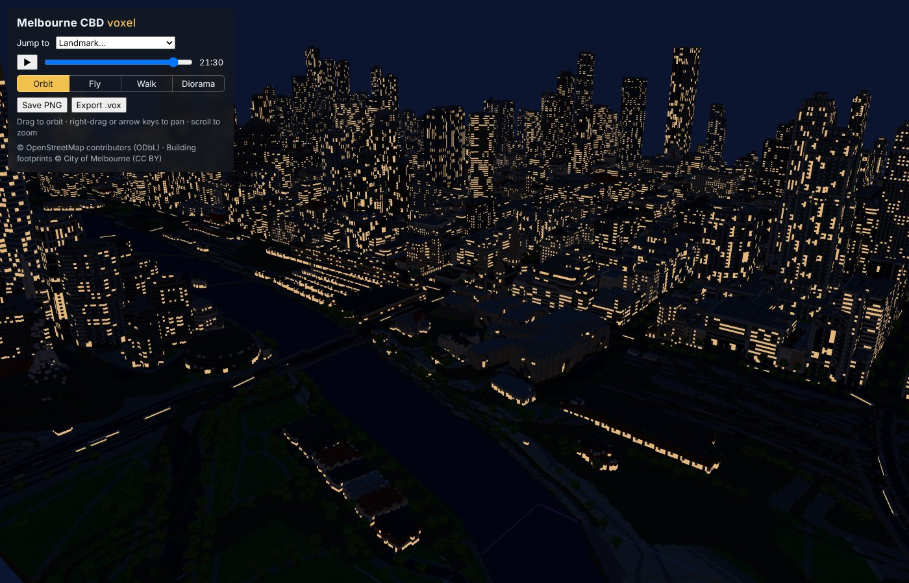 |

### Wellington, built from just its name

`npm run city -- "Wellington, New Zealand"`. No local knowledge was added: the harbour, the hills (up to 150 m), the waterfront and a jump list of eight landmarks (Te Papa, the Supreme Court, the Reserve Bank…) all came from open data.

| Overview | Diorama |
|---|---|
| 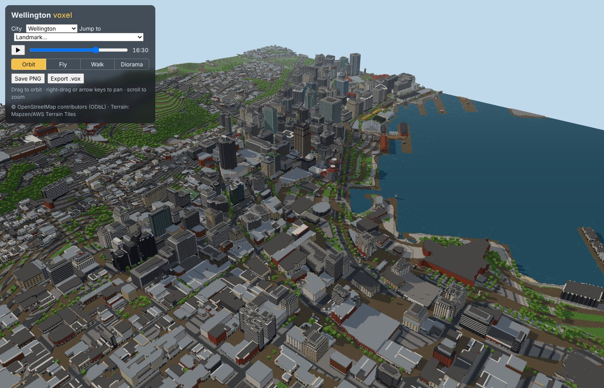 | 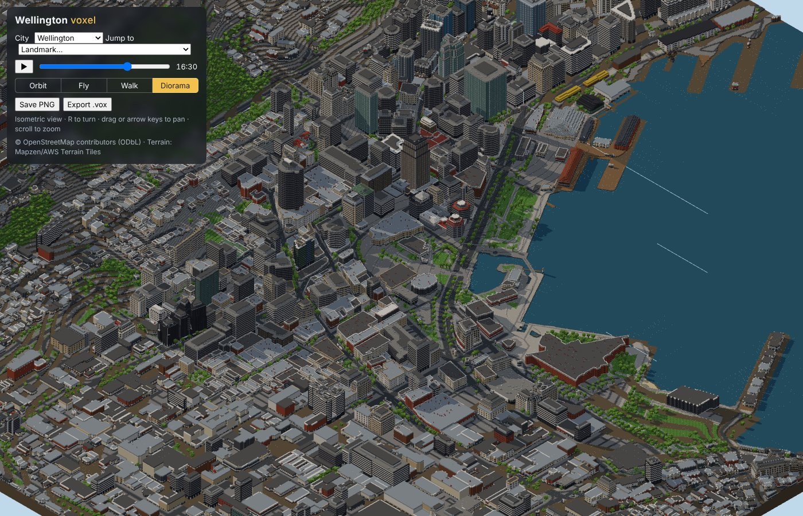 |
| **The waterfront** | **Night** |
| 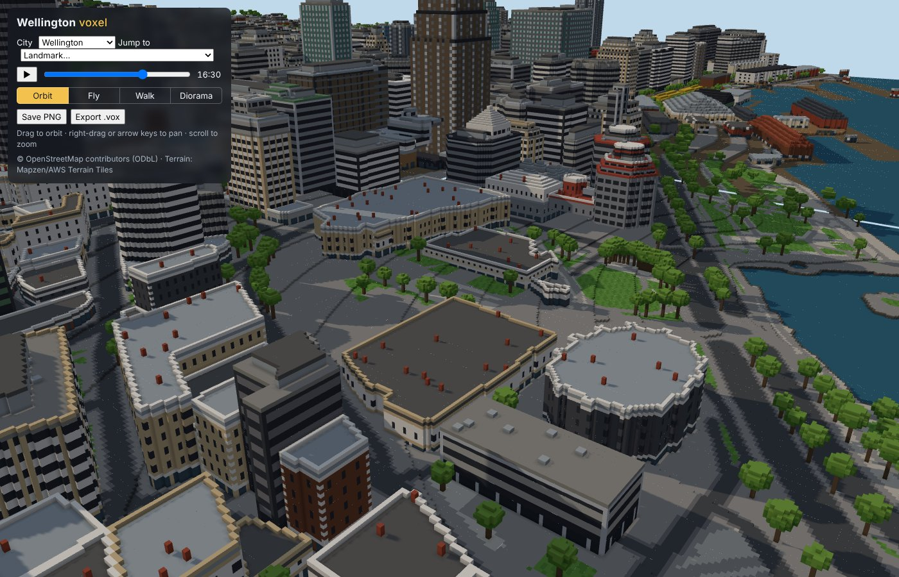 | 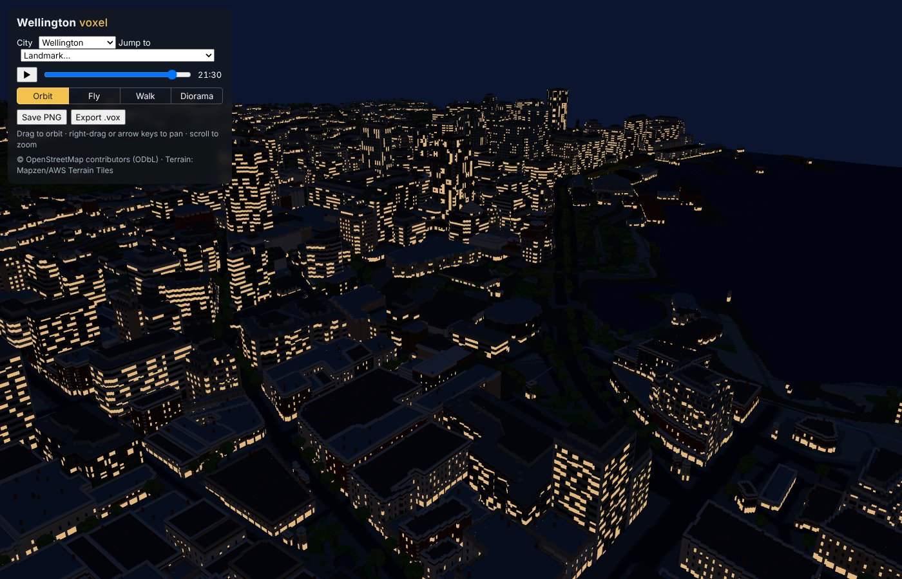 |

### Prague Old Town, 1 × 1 km

`npm run city -- "Prague Old Town Square" --size 1000 --name "Prague Old Town" --slug prague`. Terracotta roofs, the Old Town Square and the Old Town Hall, the Týn Church and the Rudolfinum come straight from OpenStreetMap's tags. The Týn Church's spires are the kind of detail a [hand-made landmark model](docs/LANDMARKS.md) adds.

| Diorama | Old Town Square |
|---|---|
| 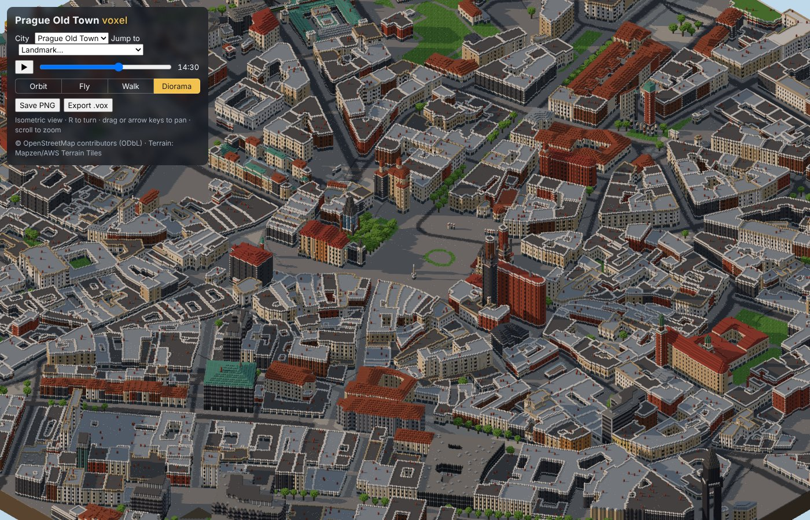 | 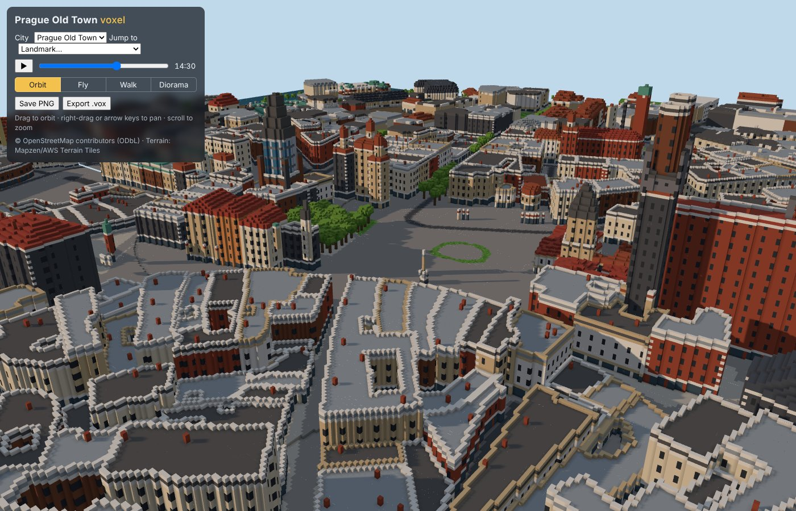 |

<!-- GALLERY -->

## Get started

| | |
|---|---|
| **Nothing to install** | Open in **GitHub Codespaces** (Code → Codespaces → Create), then run the two commands above. |
| **No computer setup at all** | **Actions → Build a city → Run workflow**, type a place, then download the result. |
| **On your computer** | Windows, macOS or Linux, with Node.js 20+ and Git: `bash scripts/setup.sh`, or `scripts\setup.ps1` on Windows. |

Step-by-step instructions for each: **[docs/QUICKSTART.md](docs/QUICKSTART.md)**.

## What you get

- **Any place on Earth**, by name (`"Kyoto Station, Japan"`) or by coordinates (`--center 40.7484,-73.9857`), up to 6 × 6 km.
- **True to the map:** every street, building footprint, park, river, tree and tram line from OpenStreetMap. Main streets are rotated onto the voxel grid, so there are no stair-steps.
- **Buildings:**
  - heights from OSM (`height`, `building:levels`) or open surveyed data;
  - facades in glass-tower, Victorian/heritage, Art Deco and warehouse styles;
  - roofs from OSM `roof:shape` (gabled, hipped, domes, onion domes, spires), recoloured by `building:colour` and `roof:colour`.
- **Terrain everywhere:** hills from the global elevation model, rivers and lakes flat at their own level, the open sea from OSM coastlines, stone foundations on slopes.
- **Landmarks:**
  - a jump list picked automatically from notable buildings;
  - hand-modelled landmarks for the buildings that define a skyline (Melbourne has 18). `npm run new-landmark` scaffolds one.
- **A living city:** a day/night cycle at the city's latitude, lit windows, animated trams and see-through glass.
- **Four cameras:** orbit, fly, walk (with collision) and an isometric diorama camera.
- **Sharing:** PNG screenshots, MagicaVoxel `.vox` export, and a static site you can host anywhere (a GitHub Pages workflow builds and publishes every city in the repository).

## How a city is made

```
"Wellington, New Zealand"
  → find it (Nominatim) and write cities/wellington/city.json
  → work out the street grid's angle (one light query)
  → download OpenStreetMap tiles across several servers, elevation tiles in parallel   (cached in data/cache/)
  → build: terrain → ground and roads → buildings and roofs → landmarks → trees → trams
  → public/cities/wellington/  → the viewer streams it, meshes it in Web Workers, and renders it
```

A 2 × 2 km city centre takes a few minutes to download (depending on how busy the free map servers are) and about 15 seconds to build. After that, rebuilding is offline. Details: [docs/ARCHITECTURE.md](docs/ARCHITECTURE.md).

## Documentation

| Guide | For |
|---|---|
| [QUICKSTART.md](docs/QUICKSTART.md) | Installing and building your first city: Codespaces, Actions, Windows, macOS, Linux |
| [USAGE.md](docs/USAGE.md) | The viewer's controls, and every command |
| [NEW_CITY.md](docs/NEW_CITY.md) | Making a city look right: the profile, tuning recipes, better data, tips by kind of city |
| [LANDMARKS.md](docs/LANDMARKS.md) | Hand-modelling landmarks with the modelling kit, including with an AI assistant |
| [ARCHITECTURE.md](docs/ARCHITECTURE.md) | How the pipeline and viewer work, file formats, how to extend them |
| [GITHUB_ACTIONS.md](docs/GITHUB_ACTIONS.md) | CI, building cities in the cloud, publishing to GitHub Pages |
| [TROUBLESHOOTING.md](docs/TROUBLESHOOTING.md) | When something goes wrong |
| [HOW_IT_WAS_BUILT.md](docs/HOW_IT_WAS_BUILT.md) | The steps, tools and prompts used to build this with an AI coding agent, and how to do the same |

## Commands at a glance

```bash
npm run city -- "<place>" [--size 2000] [--center lat,lon] [--preview]   # find, download, build
npm run city -- <city>                       # rebuild (offline)
npm run new-city -- "<place>"                # just write the profile, to edit first
npm run new-landmark -- <city> "<building>"  # start a hand-made landmark
npm run export:vox -- <city> --centre        # MagicaVoxel export
npm run screenshots -- <city>                # captures (with npm run dev running)
npm run dev                                  # the viewer: http://localhost:5173/?city=<city>
npm test                                     # unit tests
```

## Data and licences

- **Code:** the CityBuilder source code is under the [MIT License](LICENSE).
- **Map data** © [OpenStreetMap contributors](https://www.openstreetmap.org/copyright), available under the [ODbL](https://opendatacommons.org/licenses/odbl/). The viewer shows the attribution; keep it when you publish a city.
- **Terrain:** [Terrain Tiles](https://registry.opendata.aws/terrain-tiles/) on AWS (Mapzen; sources include SRTM, GMTED, ETOPO1 and national elevation models). See their attribution requirements.
- **Melbourne building footprints** © City of Melbourne, [CC BY](https://data.melbourne.vic.gov.au/).
- **Geocoding** by [Nominatim](https://nominatim.org/) (OpenStreetMap). Please keep usage light, as their [usage policy](https://operations.osmfoundation.org/policies/nominatim/) asks: one lookup per new city.
- **Built cities** are derived from these datasets and carry the same attribution requirements.

CityBuilder grew out of a Melbourne-only project, [CityPlan](https://github.com/mixalbum/CityPlan); the original plan is in [docs/ORIGINAL_PLAN.md](docs/ORIGINAL_PLAN.md).
